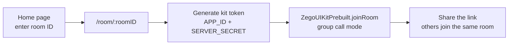

<div align="center">

# 📹 VidChatMz: Video Calling

**Start a group video call in one click and share the room link.**


### [🌐 Live demo](https://v-chat-plum.vercel.app)

</div>

---

## ✨ Features

- **Create or join a room** by entering a room ID on the home page
- **Group calls** (switch to one-on-one by changing a single `mode` setting in `Room.jsx`)
- **Shareable invite link** for each room (`/room/:roomID`)
- Camera and microphone controls, participant layout and in-call UI from the
  **[ZEGOCLOUD UIKit Prebuilt](https://www.zegocloud.com/uikits)** (WebRTC under the hood)
- Responsive UI with Tailwind CSS

## 🧠 How it works



## 🚀 Run locally

1. Create a free project at [console.zegocloud.com](https://console.zegocloud.com) and copy its **App ID** and **Server Secret**.
2. Clone and configure:

```bash
git clone https://github.com/mayurvij22/VidChatMz-Seamless-Video-Calling-.git
cd VidChatMz-Seamless-Video-Calling-
npm install
```

Create a `.env` file:

```env
VITE_APP_ID=your_zegocloud_app_id
VITE_SERVER_ID=your_zegocloud_server_secret
```

```bash
npm run dev      # http://localhost:5173
```

> [!NOTE]
> The app uses `generateKitTokenForTest`, which is meant for development. In production, generate tokens on a
> backend so the server secret isn't shipped to the browser.

## 🛠️ Tech stack

React · Vite · React Router · Tailwind CSS · ZEGOCLOUD UIKit (WebRTC) · Deployed on Vercel

## 📁 Project structure

```text
src/
├── App.jsx          # Routes: / and /room/:roomID
└── pages/
    ├── home.jsx     # Enter or create a room ID
    └── Room.jsx     # Joins the ZEGOCLOUD room and renders the call UI
```

---

<div align="center">

Made by **[Mayur Patil](https://github.com/mayurvij22)**

</div>
